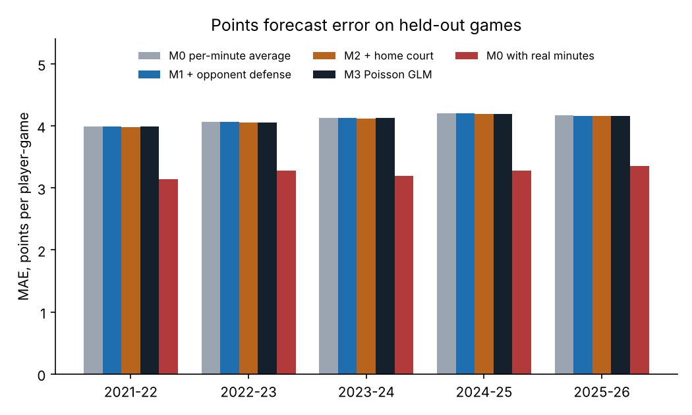
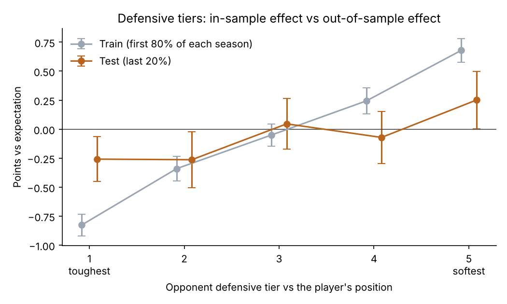

# EuroLeague Impact Lab

Python analysis of five EuroLeague seasons (2021-22 to 2025-26) built on the official EuroLeague API.

**Interactive results page:** https://sharas310.github.io/euroleague-analytics/

The project answers three questions:

1. **How much does a team lose when a key player is missing?** Team results with and without each player who averages 20+ minutes, adjusted for opponent strength and home court.
2. **Which teams defend which positions well?** Points allowed to PG, SG, SF, PF and C compared with what the same players usually score.
3. **Does knowing the opponent improve a points forecast?** Four models tested on games they never saw.

## Key findings

| Question | Result |
|---|---|
| Matchup models | Adding opponent defense and home court reduces forecast error by only **0.24%** (MAE 4.117 → 4.107 points). |
| Where the error comes from | If a player's real minutes were known in advance, error would drop by **21%** (MAE 4.117 → 3.252). Playing time matters far more than the opponent. |
| Defensive tiers | The gap between the toughest and the softest defensive tier is **1.50 points** in training data but only **0.51 points** on held-out games. About two-thirds of the apparent effect is noise. |
| Player absence | 197 players with at least one missed game. Single-player estimates are noisy: the absence-based impact and plus-minus on/off barely agree (r = 0.05 for players with 5+ missed games). |





## Methods

- **Team ratings:** ridge regression on game margins (team strength + home-court advantage) per season. Every game gets an expected margin; the residual is what a player's presence or absence is measured against.
- **Absence impact:** adjusted margin with the player minus adjusted margin without him, only counting games between his first and last game for the team. The estimate is shrunk by `n / (n + 6)` where `n` is games missed. Welch's t-test gives a p-value; on/off per 40 minutes comes from plus-minus.
- **Roles:** the API only labels players Guard, Forward or Center. K-means on per-40 profiles (assists, rebounds, offensive rebounds, blocks, steals, 3-point rate, free-throw rate) splits them into PG, SG, SF, PF and C. A `data/positions.csv` file with `Player_ID,Role` can override the clustering.
- **Points models:**
  - `M0` player points per minute (shrunk toward the role average) × expected minutes (last 10 games)
  - `M1` M0 × opponent defense against that role
  - `M2` M1 × home/away factor
  - `M3` Poisson GLM (scikit-learn `PoissonRegressor`): player + team + opponent×role + home, with stronger regularisation on the opponent×role terms
  - Shrinkage strength and regularisation are tuned on the last 15% of the training window.
- **Validation:** each season separately; the first 80% of games (chronological) train, the last 20% test. Roles for the test are assigned from training games only, so no future information leaks in.

## Project structure

```
euroleague-analytics/
├── src/
│   ├── euroleague_download.py   # API download with caching, resume and rate-limit back-off
│   ├── euroleague_analysis.py   # part 1 (absence impact) and part 2 (matchup models, defender on/off)
│   └── euroleague_tiers.py      # defense rating by position, 5 tiers, train vs test check
├── docs/index.html              # interactive results page (GitHub Pages)
├── assets/                      # charts used in this README
├── requirements.txt
└── LICENSE
```

`data/` and `output/` are created when you run the scripts and are not committed.

## How to run

```bash
python -m pip install -r requirements.txt

# 1. Download box scores for 2021-22 to 2026-27 (cached per game, safe to re-run)
python src/euroleague_download.py

# 2. Absence impact + matchup models -> output/1_*.csv, output/2_*.csv, output/results.xlsx
python src/euroleague_analysis.py

# 3. Defense rating by position and tier test -> output/3_*.csv, output/3_tiers.png
python src/euroleague_tiers.py

# Single forecast: Kostas Sloukas at home against Olympiacos
python src/euroleague_analysis.py --predict sloukas --vs OLY --home
```

Optional: `python src/euroleague_download.py --pbp` downloads play-by-play with lineups, which enables the individual defender on/off analysis in `euroleague_analysis.py`.

## Outputs

| File | Content |
|---|---|
| `1_impact_all_seasons.csv` | Absence impact and on/off per player, all seasons pooled |
| `1_impact_by_season.csv` | Same, per player-season |
| `2_model_test.csv` | MAE, RMSE and bias for M0-M3 per season, with and without known minutes |
| `2_defense_vs_role.csv` | Points allowed by each team to each role, ratio and GLM factor |
| `2_test_predictions.csv` | Every held-out prediction, for further checks |
| `3_defense_rating.csv` | Defense rating and tier per team and position for the latest season |
| `3_tiers_overall.csv` | Points vs expectation by tier, train and test, with 95% CI |

## Limitations

- Most players missed only a few games, so "without" samples are small. Shrinkage reduces the noise but does not remove it.
- Box scores do not distinguish injuries from rest days or suspensions.
- Roles come from clustering and are an approximation of real positions.

## Next steps

- Model minutes directly (rotation patterns, foul trouble, back-to-backs), since that is where most of the forecast error comes from.
- Use lineup data to measure individual defenders across several seasons.
- Pool seasons with time-decaying weights instead of testing each season alone.

## Data

Official EuroLeague API via the open-source [`euroleague-api`](https://github.com/giasemidis/euroleague_api) Python package.

## Author

Šarūnas Ramanauskas, Fachinformatiker für Daten- und Prozessanalyse (in training), Moers / Duisburg, Germany.
